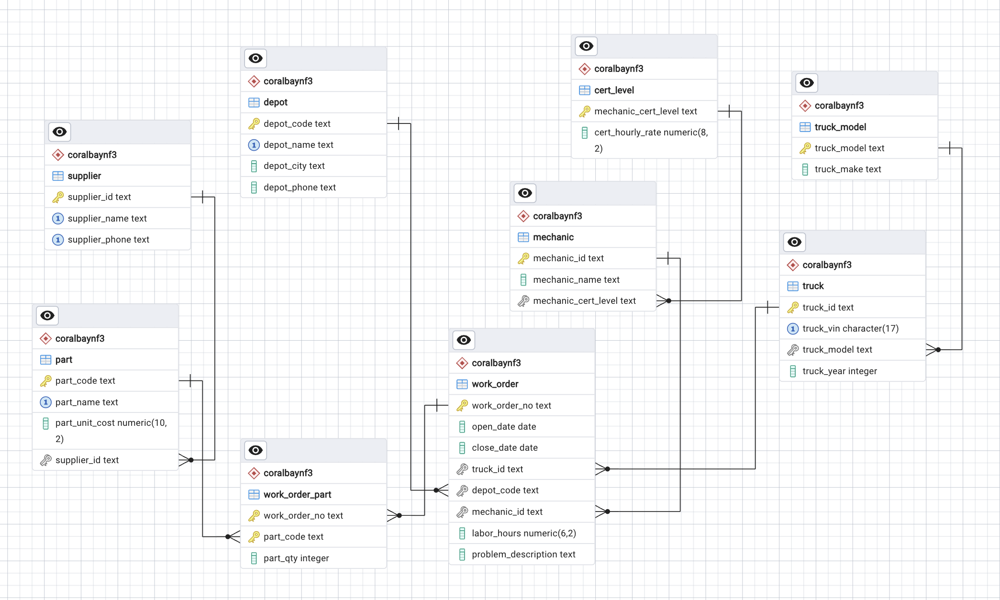
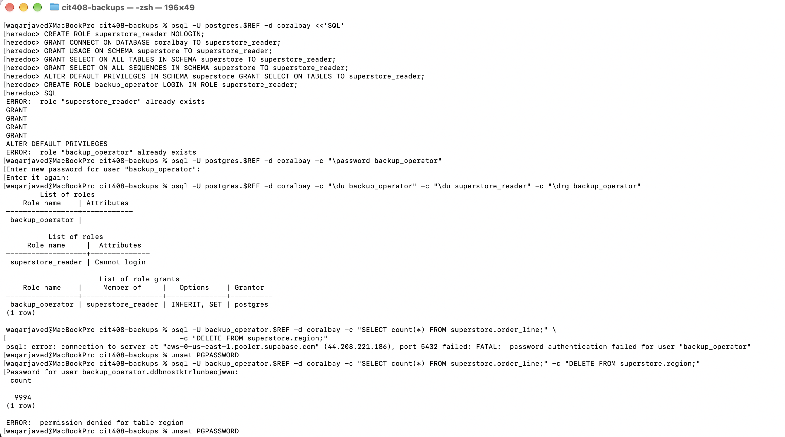
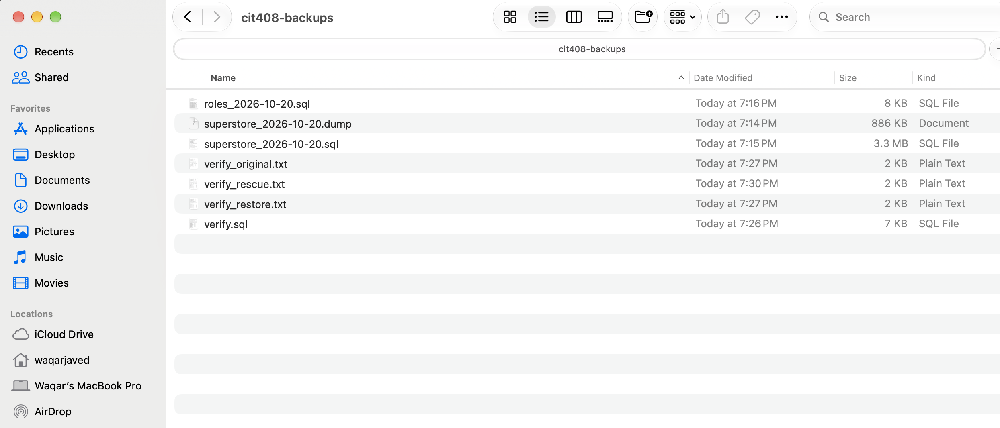
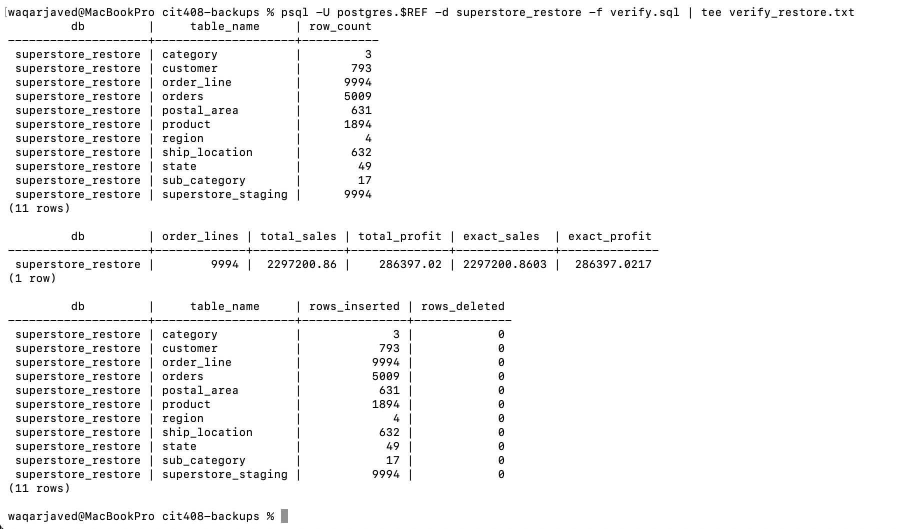
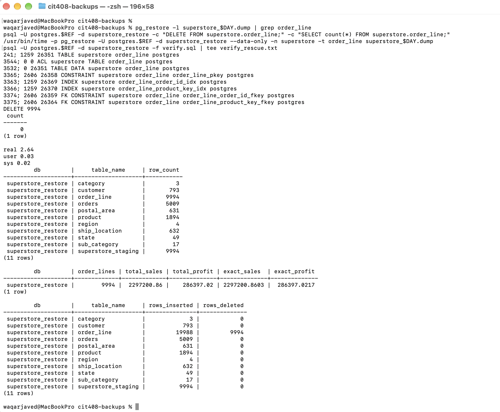
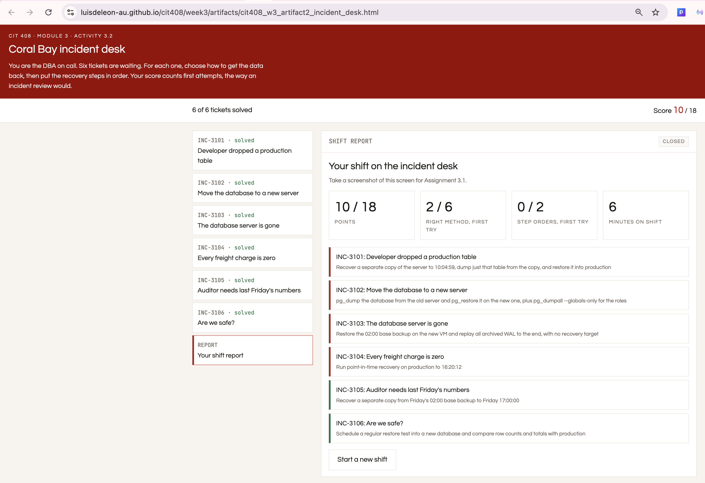
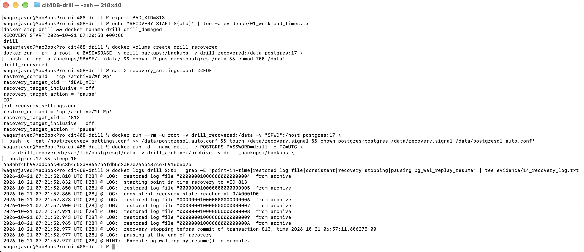
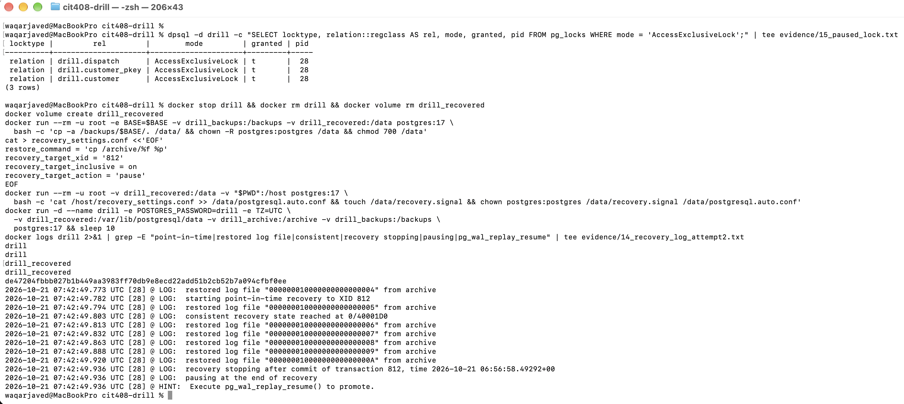
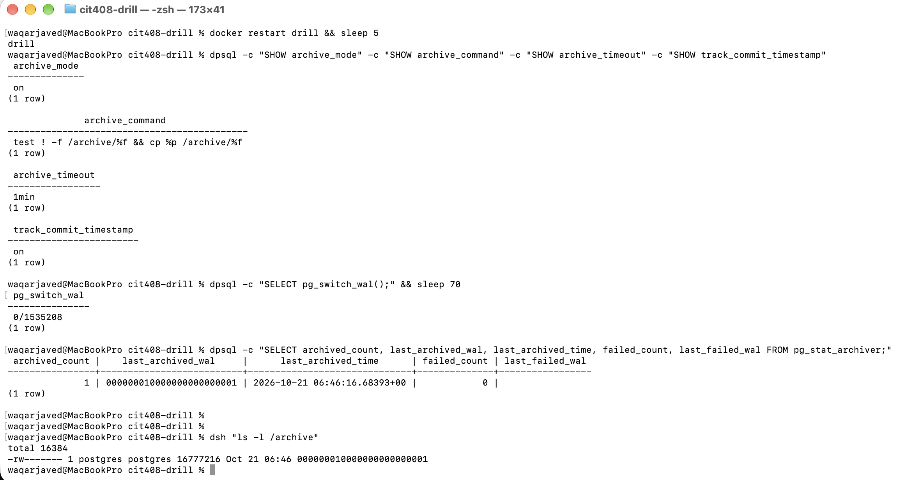

# CIT 408 · Coral Bay Logistics Database

Coursework for **CIT 408: Database Management Operations & Optimization** (Atlantis University, Fall "B" 2026), built on PostgreSQL around a fictional Florida freight company, **Coral Bay Logistics**.

Each week's folder holds the SQL, written analysis and diagrams for that week's assignment. Every query was run on a real database, and its output is pasted under it as a comment. You can learn from the files without running anything, or load the data and check each result yourself.

| Folder | Topic | Status |
|---|---|---|
| [`week2/`](week2/) | Assignment 2.1: normalization design for the fleet work orders (UNF → 1NF → 2NF → 3NF) | Submitted |
| [`week2/superstore/`](week2/superstore/) | Assignment 2.3: normalize the 9,994-line Superstore retail file and build it in PostgreSQL | Submitted |
| [`week3/backup/`](week3/backup/) | Assignment 3.1: back up Superstore, restore it, rescue a single table, and plan RPO/RTO | Submitted |
| [`week3/drill/`](week3/drill/) | Assignment 3.2: point-in-time recovery drill, finding an unknown incident and recovering to the second | Submitted |

---

## Week 2: Normalizing a messy spreadsheet, with proof

### The problem

The fleet maintenance team tracked every repair in one flat sheet: **1,100 work orders, 46 columns**. Each row repeated the truck, depot, mechanic and supplier details. Up to four parts were stored in numbered column groups, `part1_*` to `part4_*`.

```
work_order_no | truck_id | truck_make | depot_code | depot_phone | mechanic_id | cert_hourly_rate | part1_code | part1_supplier_name | part2_code | ... | part4_supplier_phone
```

The task was to design a normalized schema in which every decision is backed by a query.

### What's in the folder

| File | What it shows |
|---|---|
| [`explore.sql`](week2/explore.sql) | 9 exploration queries: distinct counts, empty part slots, gaps in the slot groups, and a first sign of the data conflict |
| [`dependencies.md`](week2/dependencies.md) | Every functional dependency, labeled **full**, **partial** or **transitive**, plus the dependencies rejected on business meaning and the ones that don't hold |
| [`fd_checks.sql`](week2/fd_checks.sql) | A `GROUP BY … HAVING count(DISTINCT …) > 1` proof for each dependency, with its result pasted below it, ending in a pass/fail summary |
| [`design.md`](week2/design.md) | The 1NF, 2NF and 3NF table designs with keys, and a final check of every non-key column |
| [`erd.png`](week2/erd.png) | The final 3NF ERD, generated by pgAdmin from the live schema |
| [`fd_summary.png`](week2/fd_summary.png) | Screenshot of the summary query: 14 dependencies hold and one conflicts |
| [`simulator_results.png`](week2/simulator_results.png) | Results of the course's normalization simulator |

### Key ideas, in plain terms

**1. 1NF means no repeating groups.**
`part1_code … part4_code` is a list stored sideways. The fix is to unpivot it, giving one row per part used:

```sql
SELECT w.work_order_no, p.part_code, p.part_qty, ...
FROM work_orders_unf w
CROSS JOIN LATERAL (VALUES
  (w.part1_code, w.part1_qty), (w.part2_code, w.part2_qty),
  (w.part3_code, w.part3_qty), (w.part4_code, w.part4_qty)
) AS p(part_code, part_qty)
WHERE p.part_code IS NOT NULL;
```

That produces 2,258 part lines, and the key becomes `(work_order_no, part_code)`.

**2. Prove a dependency before you rely on it.**
`A → B` holds when no value of A appears with two different values of B. A query that returns zero rows proves it:

```sql
SELECT truck_model, count(DISTINCT truck_make)
FROM wo_1nf
GROUP BY truck_model
HAVING count(DISTINCT truck_make) > 1;   -- 0 rows = truck_model → truck_make holds
```

**3. Follow every chain to its end.**
Two chains have a second link, and stopping after the first one is the most common mistake:

- `truck_id → truck_model → truck_make`
- `mechanic_id → mechanic_cert_level → cert_hourly_rate`

If `truck_make` stays in the `truck` table, it describes a non-key column (`truck_model`), which breaks 3NF. The fix is to give `truck_model` its own table. The certification rate works the same way.

**4. Real data has conflicts, so state your rule.**
One check fails. Depot `DEP-FLL` shows two phone numbers: `(954) 555-0118` on 266 work orders and `(954) 555-0181` on 2 (WO-50041 and WO-50047). The rule used is **majority value wins, and ties are flagged for review**. The variant looks like a typo, with its last two digits swapped, and it only appears over two days in January.

**5. Some patterns hold only by coincidence.**
`truck_make → truck_model` holds in this data only because the fleet owns one model per make. A business rule describes what must always be true, so this pattern is documented as rejected and is not enforced.

### The final 3NF design (9 tables)



*The ERD pgAdmin generated from the nine built tables.*

```
truck_model ──< truck ──< work_order >── depot
                              │  ^
cert_level ──< mechanic ──────┘  │
                                 │
supplier ──< part ──< work_order_part
```

| Table | Primary key | Foreign keys |
|---|---|---|
| truck_model | truck_model | |
| truck | truck_id | truck_model |
| depot | depot_code | |
| cert_level | mechanic_cert_level | |
| mechanic | mechanic_id | mechanic_cert_level |
| supplier | supplier_id | |
| part | part_code | supplier_id |
| work_order | work_order_no | truck_id, depot_code, mechanic_id |
| work_order_part | (work_order_no, part_code) | work_order_no, part_code |

Rejoining the nine tables reproduces the 1NF data exactly. The only difference is the corrected phone number on the two conflicting work orders.

### Run it yourself

1. Load the course-provided CSV (not included in this repo) into a table called `work_orders_unf` (PostgreSQL 16+).
2. Run `fd_checks.sql` from top to bottom. Step 0 creates the `wo_1nf` view, and the last query prints the summary.
3. Compare your output with the results pasted in the file.

---

## Week 2: Superstore, from flat file to a working 3NF database

### The problem

`Superstore.csv` is a public retail dataset with 9,994 order lines from a U.S. office-supply store. Each row repeats the order, the customer, the ship-to address and the product. The assignment has four parts: load the file, prove every dependency, design 3NF, then build that design with real keys and constraints and verify it.

### What's in the folder

| File | What it shows |
|---|---|
| [`load.sql`](week2/superstore/load.sql) | Schema, staging table, and the CSV load (the file is Windows-1252, not UTF-8) |
| [`fd_checks.sql`](week2/superstore/fd_checks.sql) | Key and dependency proofs, with results pasted in, ending in a summary |
| [`design.md`](week2/superstore/design.md) | Every decision explained, then the 1NF, 2NF and 3NF tables with keys |
| [`create_tables.sql`](week2/superstore/create_tables.sql) | 10 tables with primary keys, 9 foreign keys, NOT NULL and 7 CHECK constraints |
| [`load_data.sql`](week2/superstore/load_data.sql) | `INSERT … SELECT DISTINCT`, parent tables before child tables |
| [`verify.sql`](week2/superstore/verify.sql) | Row counts, a full rejoin, a sales-total match, and a deliberate foreign-key violation |
| [`erd.png`](week2/superstore/erd.png) · [`verify_output.png`](week2/superstore/verify_output.png) | The ERD generated by pgAdmin, and the verification results |

### What the data showed, even though the column names suggested otherwise

| Assumption from the column names | What the data showed | Decision |
|---|---|---|
| `(order_id, product_id)` identifies a line | 8 orders list the same product twice | Key the line table on `row_id` and keep all 9,994 lines |
| `product_id` identifies a product | 32 IDs each name two different products at different prices | Add a surrogate `product_key` and make `(product_id, product_name)` unique |
| City and postal code describe the customer | 780 of 793 customers ship to more than one place | The ship-to address belongs on `orders` |
| A postal code names one city | 92024 is recorded as both San Diego and Encinitas | A ship-to location is keyed on `(postal_code, city)` |
| Postal codes are 5 digits | 438 New England codes lost their leading zero | Store them as text and pad them back (`1841` → `01841`) |

### Proof that it works


*The ERD pgAdmin generated for the ten Superstore tables. The staging table stands alone.*


- Rejoining all 10 tables returns **9,994 rows**, and they match the staging data **column for column** (0 differences either way).
- Total sales are **$2,297,200.8603** in both the staging table and the 3NF tables.
- Inserting a line for a product that doesn't exist is rejected with `violates foreign key constraint "order_line_product_key_fkey"`.

---

## Week 3: Backing up Superstore and proving the restore

### The problem

The Superstore database from Week 2 held 9,994 order lines with no backup, so a server failure would have lost all of it. The task was to back it up the way a DBA would, restore it, rescue one damaged table, and prove each step with numbers rather than with "no errors".

### What's in the folder

| File | What it shows |
|---|---|
| [`commands.md`](week3/backup/commands.md) | Every command in order, with a one-line explanation, written so anyone can repeat it |
| [`verify.sql`](week3/backup/verify.sql) | Row counts, sales and profit totals, and per-table write statistics, with the output of all three runs pasted in |
| [`backup_plan.md`](week3/backup/backup_plan.md) | Schedule, retention, where copies live, restore testing, and the RPO and RTO, all based on measured times |
| Screenshots `01`–`07` | Shift report, role setup, timed dumps, backup folder, full restore, rescue, and the restored database in pgAdmin |

### 1. A backup role that can only read

`backup_operator` can log in but holds no privileges of its own. It inherits `SELECT` from a group role, `superstore_reader`, and nothing more. It read all 9,994 order lines, and a `DELETE` was refused with `permission denied`.



### 2. Three backups, written straight to my computer

pg_dump ran on my Mac and pulled the data over the network from Supabase, so every file was off the server from the moment it was written. Each file name carries the date.

| Backup | Purpose | Size | Time |
|---|---|---|---|
| `superstore_2026-10-20.dump` | Custom format: compressed, and restorable one table at a time | 865 KB | 15.03 s |
| `superstore_2026-10-20.sql` | Plain SQL: readable, and replayable with psql alone | 3.2 MB | 14.22 s |
| `roles_2026-10-20.sql` | Server roles and memberships, without passwords | 7.9 KB | 11.13 s |



One lesson came up immediately. My Mac had pg_dump 14, and the server runs PostgreSQL 17.6. pg_dump refuses to dump a server newer than itself, so I installed the version 17 client tools first.

### 3. Full restore, proven to the cent

I restored the custom dump into a new database, `superstore_restore`, in 9.59 s, then ran the same checks on both databases.

| Check | Original | Restored |
|---|---|---|
| Row counts, all 11 tables | 3 to 9,994 | identical |
| Total sales | 2,297,200.86 | 2,297,200.86 |
| Total profit | 286,397.02 | 286,397.02 |



### 4. Rescuing one table without touching the others

In the restored copy only, I deleted all 9,994 order lines, then restored just that table's data from the dump:

```bash
pg_restore --data-only -n superstore -t order_line superstore_2026-10-20.dump
```

It took 2.64 s, and the counts and totals matched again. PostgreSQL's per-table statistics show that nothing else was touched: only `order_line` shows a delete (9,994) and a second load (19,988 rows inserted). Every other table was loaded once and never changed.



### 5. The plan

| | |
|---|---|
| Schedule | Custom dump nightly at 02:00; plain and roles dumps weekly |
| Retention | 14 daily, 8 weekly, 12 monthly |
| Copies | 3-2-1: the server, my computer, and cloud storage off-site |
| Restore test | Weekly full restore plus verify; monthly single-table drill |
| **RPO** | **24 hours** (one dump per night) |
| **RTO** | **1 hour** for a full restore; about 15 minutes for one table |

The measured work is small: about 10 seconds to restore. Most of the RTO is people's time: noticing the failure, finding the right file, and checking the result.

### Recovery decisions (Activity 3.2)

The course's incident desk set six recovery tickets, ranging from a dropped table to a lost server and an auditor needing last Friday's numbers. For each one I chose the recovery method.



---

## Week 3: Recovery drill, finding the incident and recovering to the second

### The problem

With continuous WAL archiving running, a script played back ten minutes of dispatch work, and somewhere inside it something went wrong. I didn't know what or when. The job was to find the damage and its exact moment, bring the database back to just before it, lose as little good work as possible, and write an incident report for a non-technical manager.

The drill ran on PostgreSQL 17 in Docker, because point-in-time recovery needs full control of the server (archive settings, the data directory, restarting into recovery). A managed service doesn't give that.

### What's in the folder

| File | What it shows |
|---|---|
| [`incident_report.md`](week3/drill/incident_report.md) | The report: timeline in UTC and Eastern, evidence, recovery target, losses, RPO/RTO, prevention |
| [`commands.md`](week3/drill/commands.md) | Every command in order, including the first recovery attempt and why it was redone |
| [`evidence/`](week3/drill/evidence/) | Everything saved before recovery: server log, pg_waldump analysis, table activity, and the batches that were about to be lost |
| [`verify.sql`](week3/drill/verify.sql) | Checks run while recovery was paused and after it finished, with both outputs |

### 1. What happened

The incident was `DROP TABLE drill.customer CASCADE`. It removed all 500 customers, and the foreign key from every dispatch to its customer. Four sources agree on it:

| Source | Evidence |
|---|---|
| Server log | `06:57:11.600 UTC … statement: DROP TABLE drill.customer CASCADE;` |
| pg_waldump | `tx: 813 … COMMIT 2026-10-21 06:57:11.606275 UTC; rels: base/16388/16390 base/16388/16393`: the only commit that deleted files |
| Commit order | 812 (batch 8) at 06:56:58 → **813 (the DROP)** at 06:57:11 → 814 (batch 9) at 06:57:59 |
| Live database | `to_regclass('drill.customer')` returned nothing; the foreign key was gone |

The work kept running after the DROP, so six more batches were saved on top of the damage.

### 2. Recovering to the right moment

I targeted a **transaction ID instead of a time**. During the drill, the same instant showed as 06:57:11 UTC in the server log and 02:57:11 EDT in pg_waldump, so a time typed in the wrong zone would have missed by four hours. A transaction ID is the same in every tool.

The first attempt stopped just before transaction 813, in exactly the right place:



But while it was paused, every query on the customer table hung. The DROP takes an exclusive lock a moment before it commits, and a recovery paused before that commit still holds the lock. So I discarded the attempt and recovered again, stopping **just after transaction 812**, the last good batch. No other work committed in between, so the data is identical, and this time it could be checked:



| Checked while paused | Result |
|---|---|
| Customer table | Back, with all 500 rows and the foreign key |
| Batches 1–8 (before the DROP) | All present |
| Batches 9–14 (after the DROP) | None present: the expected loss |
| Dispatches / lines | 21,200 / 52,400, exactly the expected counts |

Only then did I finish recovery. I removed the recovery settings, took a fresh base backup on the new timeline, and kept the damaged data directory untouched.



### 3. The outcome

| | |
|---|---|
| **Data lost before the incident** | None. The recovery point is 13 seconds before the DROP. |
| **Work that arrived after it** | Batches 9–14 (900 dispatches, 1,800 lines). They were exported before recovery, so they can be reloaded rather than retyped. |
| **RTO** | 25 min 20 s of downtime; 43 min 30 s from detection. The WAL replay itself took under a second. |
| **Prevention** | A non-owner login for the application, an event trigger that blocks DROP, alerts on destructive statements, and a delayed standby replica |

---

## Tools

PostgreSQL 17 (Supabase and Docker) · psql, pg_dump, pg_dumpall, pg_restore, pg_basebackup, pg_verifybackup and pg_waldump · pgAdmin 4 · Git and GitHub

## Author

**Waqar Javed** · [GitHub @iamwaqarjaved](https://github.com/iamwaqarjaved)

## License

[MIT](LICENSE). You're welcome to learn from this work. If you're taking the same course, use it to understand the method and write your own analysis.
